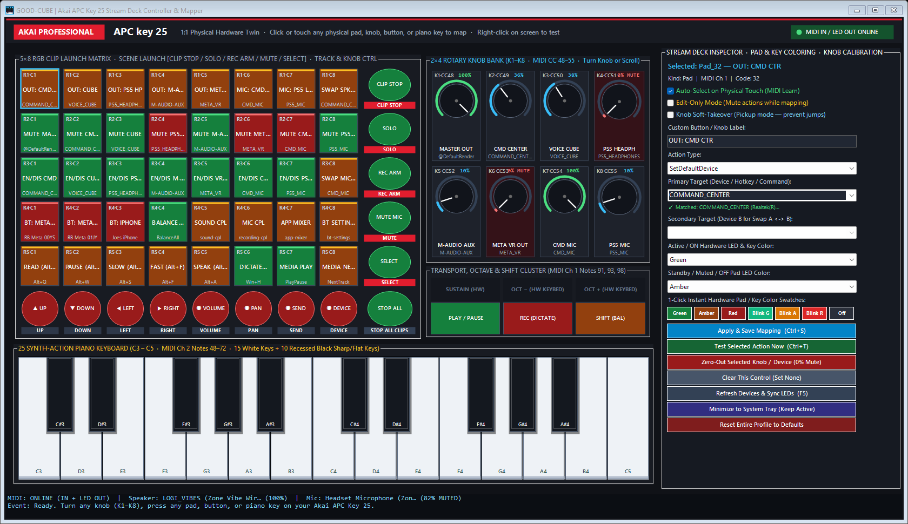

# APC-DECK — Akai APC Key 25 Stream Deck Controller & Mapper

Native Windows visual controller, hardware LED synchronizer, and Stream Deck–style action mapper for the **Akai Professional APC Key 25** (`USB\VID_09E8&PID_0027`).



`APC-DECK` turns all **90 mappable physical controls** on the Akai APC Key 25—**8 rotary knobs (`K1`–`K8` in a `2×4` bank)**, **40 RGB clip-launch pads (`5×8` matrix)**, **6 circular scene launch / stop buttons**, **8 circular track/knob-control buttons**, **3 transport/shift buttons (`PLAY/PAUSE`, `REC`, `SHIFT`)**, and **25 synth-action piano keys (`C3`–`C5` with 15 white keys + 10 recessed black sharp/flat keys)**—into a zero-latency audio mixer, device router, Bluetooth wake-up controller, and hotkey macro surface.

---

## Documentation Suite

| Document | Contents |
| :--- | :--- |
| **[README.md](README.md)** | Quick start, launching, default 90-control workstation layout, performance metrics, and verification |
| **[AGENTS.md](AGENTS.md)** | Authoritative repository-root instructions and architectural invariants for Codex / AI coding agents |
| **[docs/AGENT_HANDOFF.md](docs/AGENT_HANDOFF.md)** | Complete engineering handoff & current-state reference across all 5 passes (resolved issues, caching architecture, desktop IPC) |
| **[docs/USER_GUIDE.md](docs/USER_GUIDE.md)** | Step-by-step operational guide: 1:1 hardware twin navigation, MIDI Learn, 1-click pad/key color swatches, knob zero-out & soft-takeover pickup |
| **[docs/HARDWARE_MIDI_SPEC.md](docs/HARDWARE_MIDI_SPEC.md)** | Complete Akai APC Key 25 (MK1) MIDI IN/OUT protocol, canonical `ControlId` coordinates, hardware LED velocity table, and WinMM lifecycle |
| **[docs/REA_STREAMDECK_ANALYSIS.md](docs/REA_STREAMDECK_ANALYSIS.md)** | Reverse-engineering dossier (REA Evidence IDs, SHA-256 digests, CoreAudio `IPolicyConfig` COM vtable, WinRT RFCOMM `0x111E` Bluetooth wake-up, and CoreAudio caching) |

---

## How to Open `APC-DECK`

1. **Desktop Shortcut (Recommended)**:
   - Double-click **`APC-DECK`** on your Windows Desktop (`C:\Users\jdben\Desktop\APC-DECK.lnk`).
   - If `APC-DECK` is already running in the background or minimized to the system tray, double-clicking the desktop shortcut immediately restores the window to the foreground on your primary display (`\\.\DISPLAY1`).
2. **From Any Terminal (PowerShell / CMD)**:
   ```powershell
   apc-deck
   ```
3. **Direct PowerShell Launch**:
   ```powershell
   pwsh -NoLogo -NoProfile -STA -File C:\Tools\apc-midi-deck\Open-ApcDeck.ps1
   ```
4. **CLI Modes**:
   ```powershell
   # Start minimized in the Windows System Tray (via apc-deck shim or pwsh)
   apc-deck -Minimized
   apc-deck -Mode Tray

   # Inspect live MIDI indices, 90-control count, audio endpoints, and Bluetooth status as JSON
   pwsh -NoLogo -NoProfile -File C:\Tools\apc-midi-deck\Open-ApcDeck.ps1 -Mode Snapshot

   # Reset all 90 controls to the default workstation layout
   pwsh -NoLogo -NoProfile -File C:\Tools\apc-midi-deck\Open-ApcDeck.ps1 -Mode ResetDefaults

   # Stop a running background instance cleanly (clears hardware LEDs)
   pwsh -NoLogo -NoProfile -File C:\Tools\apc-midi-deck\Open-ApcDeck.ps1 -Mode Stop
   ```

---

## Key Capabilities & Runtime Performance

- **60 Hz Sub-Millisecond Rotary Knobs (`K1`–`K8`) with Clean `0%` Zero-Out**:
  - Uses a 4-tier in-memory CoreAudio `MMDevice` & `FriendlyName` cache (`$script:EndpointCache`, `$script:SnapshotDevices`, `$script:FriendlyNameCache`, `$script:NegativeEndpointCache`) plus single-control GDI+ invalidation (`Invalidate-ApcControl`) so turning any knob adjusts volume and repaints in **`0.15 ms – 1.0 ms`**, with **`0.0 ms/sec` idle CPU usage**.
  - **Deadzone Zero-Out (`CC <= 1` → `0%` & Auto-Mute)**: Turning a knob fully counter-clockwise snaps cleanly to `0%` and mutes the device so there is zero audio bleed; turning it up (`CC >= 2`) automatically unmutes. Turning fully clockwise (`CC >= 126`) snaps cleanly to `100%`.
  - **Optional Soft-Takeover (Pickup Mode)**: Check **Knob Soft-Takeover (Pickup mode — prevent jumps)** in the Inspector to prevent sudden volume jumps when a physical knob position differs from Windows volume—the knob waits until you cross the current Windows volume level before locking on.
  - **1-Click Zero-Out Button**: Click **Zero-Out Selected Knob / Device (0% Mute)** in the Inspector to immediately zero and mute any selected knob or audio device.
- **Full Hardware Pad & Visual Piano Key Color Customization**:
  - Configure both the **Active / ON Hardware LED & Key Color** (`Auto`, `Green`, `BlinkGreen`, `Amber`, `BlinkAmber`, `Red`, `BlinkRed`, `Off`) and **Standby / Muted / OFF Pad LED Color** (`Auto`, `Amber`, `Red`, `Green`, `BlinkAmber`, `BlinkRed`, `BlinkGreen`, `Off`) for any pad.
  - Use the **1-Click Instant Hardware Pad / Key Color Swatches** (`Green`, `Amber`, `Red`, `Blink G`, `Blink A`, `Blink R`, `Off`) to recolor any physical pad or on-screen piano key (`C3`–`C5`) immediately.
  - **Differential USB MIDI LED Sync**: `Sync-ApcHardwareLeds` caches the last velocity sent per note (`$script:LastSentLedVel`) and only transmits `midiOutShortMsg` when a pad's state actually changes.
- **Stream Deck–Style MIDI Learn & Right-Click Instant Test**:
  - Touch any knob, pad, scene/track button, transport button, or piano key on the physical APC Key 25 to highlight it in cyan and load its mapping in the right-hand Inspector in `< 13 ms`.
  - **Right-click** any pad, button, knob, or piano key directly on the UI canvas to select and test its bound action immediately without touching the hardware.
  - Check **Edit-Only Mode (Mute actions while mapping)** to press pads/keys or turn knobs freely while assigning them without firing hotkeys or changing volumes.

---

## Default 90-Control Layout

| Section | Control IDs | MIDI Coordinates | Default Assignment |
| :--- | :--- | :--- | :--- |
| **Knobs `K1`–`K8` (`2×4` Bank)** | `Knob_48`–`Knob_55` | Ch 1 `CC 48`–`55` | `K1` **Master Out**, `K2` **`COMMAND_CENTER`**, `K3` **`VOICE_CUBE`**, `K4` **`PS5_HEADPHONES`**, `K5` **`M-AUDIO-AUX`**, `K6` **`META_VR`**, `K7` **`CMD_MIC`**, `K8` **`PS5_MIC`** |
| **Pad Row 1 (Top)** | `Pad_32`–`Pad_39` | Ch 1 `Note 32`–`39` | **Set Default Device**: `CMD CTR` (`32`), `CUBE` (`33`), `PS5 HP` (`34`), `M-AUDIO` (`35`), `META VR` (`36`), `CMD MIC` (`37`), `PS5 MIC` (`38`), **`SWAP SPK A/B`** (`39`) |
| **Pad Row 2** | `Pad_24`–`Pad_31` | Ch 1 `Note 24`–`31` | **Mute / Unmute Toggle**: `Master` (`24`), `CMD CTR` (`25`), `CUBE` (`26`), `PS5 HP` (`27`), `M-AUDIO` (`28`), `META VR` (`29`), `CMD MIC` (`30`), `PS5 MIC` (`31`) |
| **Pad Row 3** | `Pad_16`–`Pad_23` | Ch 1 `Note 16`–`23` | **Enable / Disable Endpoint**: `CMD CTR` (`16`), `CUBE` (`17`), `PS5 HP` (`18`), `M-AUDIO` (`19`), `META VR` (`20`), `CMD MIC` (`21`), `PS5 MIC` (`22`), **`SWAP MIC A/B`** (`23`) |
| **Pad Row 4** | `Pad_8`–`Pad_15` | Ch 1 `Note 8`–`15` | **Bluetooth & Tools**: `RB Meta 00YS` (`8`), `RB Meta 01JY` (`9`), `Joes iPhone` (`10`), **`BALANCE 95%`** (`11`), `Sound CPL` (`12`), `Mic CPL` (`13`), `App Mixer` (`14`), `BT Settings` (`15`) |
| **Pad Row 5 (Bottom)** | `Pad_0`–`Pad_7` | Ch 1 `Note 0`–`7` | **Hotkeys & Media**: Speechify `Alt+Q` (`0`), `Alt+W` (`1`), `Alt+S` (`2`), `Alt+F` (`3`), `Alt+A` (`4`), Dictate `Win+H` (`5`), `Play/Pause` (`6`), `Next Track` (`7`) |
| **Scene & Track Buttons** | `Scene_81`–`Scene_86`, `Track_64`–`Track_71` | Ch 1 `Note 81`–`86`, `64`–`71` | Media transport (`Stop`, `Prev`, `Next`, `Vol+`, `Vol-`), `Mute Default Mic`, `Balance All`, and quick Windows Sound/Mixer launchers |
| **Transport & Shift** | `Trans_91`, `Trans_93`, `Trans_98` | Ch 1 `Note 91`, `93`, `98` | `PLAY/PAUSE` (`MediaKey PlayPause`), `REC (WIN+H)` (`Hotkey Win+H`), `SHIFT` (`SystemCommand app-mixer`) |
| **25 Piano Keys** | `Key_48`–`Key_72` | Ch 2 `Note 48`–`72` | `C3`–`C5` synth keys (15 white + 10 black keys) pre-mapped and customizable for hotkeys, media, audio switches, or app launchers |

---

## Testing & Verification

Run the automated verification suite (validates 90-control profile schema, knob `0%`/`100%` deadzone clamping, hotkey chord parser, LED velocity overrides, live endpoint snapshot, WinForms UI smoke test, and the `< 500 ms` 8-knob sweep latency gate):

```powershell
pwsh -NoLogo -NoProfile -File C:\Tools\apc-midi-deck\Test-ApcDeck.ps1
```
